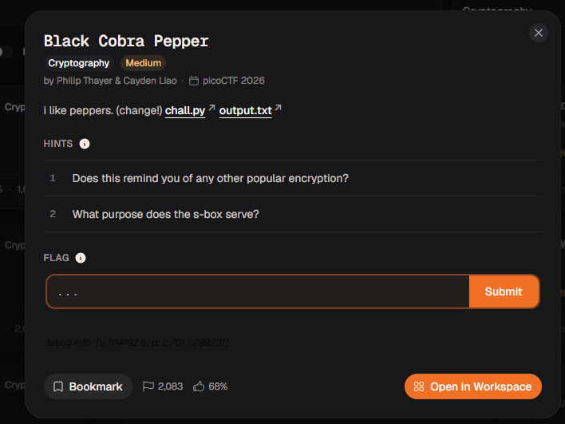

# Black Cobra Pepper

#### Category: Cryptography - Difficulty: Medium - Ngày viết: 11/17/2026

#### 1. Overview

* 
* `Mục tiêu`: Giải mã ciphertext khi ciphertext mã hóa bằng giao thức AES lỗi
* `Lỗ hỗng`: Mất tính phi tuyến tính của AES
* `Kỹ thuật`: Mọi phép biến đổi tuyến tính liên tiếp đều có thể gộp thành 1 phép biến đổi tuyến tính duy nhất

#### 2. Nền tảng cốt lõi

* Bài này cần áp dụng đại số tuyến tính mới có thể giải được :v
* Ngoài ra, ta cũng cần phải hiểu trường mở rộng Galois $\mathbb{F}_{2^8}$ được sử dụng như nào trong mã hóa AES
* Mình có viết code mã hóa [AES](AES_sagemath.py) bằng sagemath. Cơ bản các phép biến đổi:
  * `add_round_key`: Cộng giữa ma trận trạng thái và ma trận round_key trên trường Galois
  * `shift_row`: Dịch vòng trái hàng thứ $r$ đi $r$ ô
  * `mix_column`: Nhân ma trận hằng số $M_{mix}$ với ma trận trạng thái của block trên trường Galois
  * `sub_bytes`: Lấy nghịch đảo nhân từng phần tử trong ma trận trạng thái trên trường Galois, sau đó, biến đổi phần tử trong trường Galois thành Vector trên trường hữu` hạn $\mathbb{F}_2$ và biến đổi Affine trên trường $\mathbb{F}_2$

#### 3. Phân tích lỗ hỗng

* Mã nguồn server: [Đọc](chall.py)
* Các bước biến đổi của AES vẫn được giữ nguyên, tuy nhiên, ở bước `sub_bytes` đã bị loại bỏ Sbox và trả về chính trạng thái của block đó

#### 4. Ý tưởng khai thác

* Cả 3 bước `add_round_key`, `shift_rows`, `mix_column` đều là các phép biến đổi tuyến tính. Việc mất đi bước `sub_bytes` khiến cho flag chỉ bị biến đổi tuyến tính liên tiếp và khi gộp các phép biến đổi tuyến tính lại với nhau. Ta có 1 ma trận tượng trưng cho các phép biến đổi tuyến tính đó gọi là $M$.

$$
C = M * P + K_{eff}
$$

* Trong đó, $K_{eff}$ là vector khóa - tổng cộng dồn 11 khóa vòng qua các tầng khuếch tán của `shift_rows`và ` mix_column`. Bởi vì ta đã có cặp $(P_0, C_0)$ đề cho, $M$ thì được tính trực tiếp từ hàm AES của chall bằng cách ép key là byte 0   `(key = 0 khiến cho K = 0 theo)`, ta dễ dàng tìm lại được vector $K_{eff}$
* Bởi vì ta đã biết $C_{flag}$, ta đưa về phương trình 1 ẩn và tìm lại được $P$

#### 5. Exploit chain

* Quy trình:
  * Ta khai báo trường mở rộng Galois $\mathbb{F}_{2^8}$ theo chuẩn mã hóa NIST modulus là $x^8 + x^4 + x^3 + x + 1$
  * Ta tìm ma trận $M$
  * Ta tính $K_{round\_key}$
  * Ta lập phương trình 1 ẩn $M * P = C - K_{eff}$, ta giải hệ để tìm $P$
  * Đưa vector $P$ về lại bytes và thu được cờ
* Script: [Đọc](solve.py)
* ```
  academy{spi1cy!}
  ```
